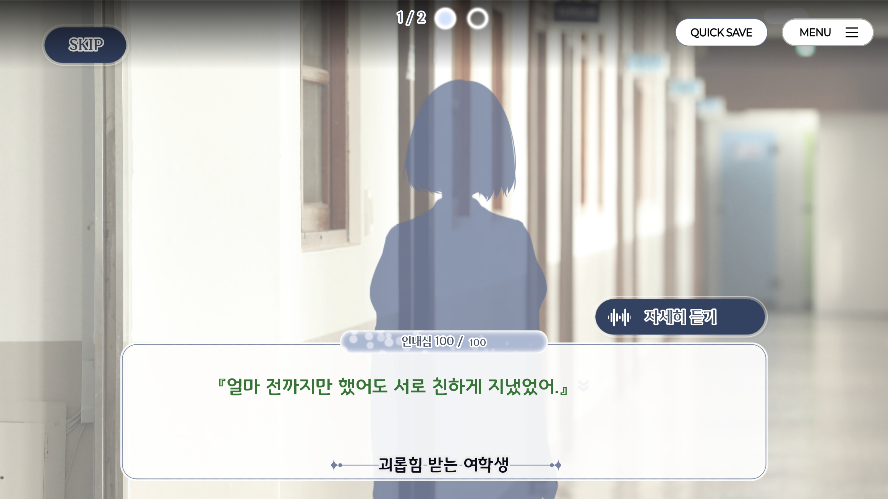
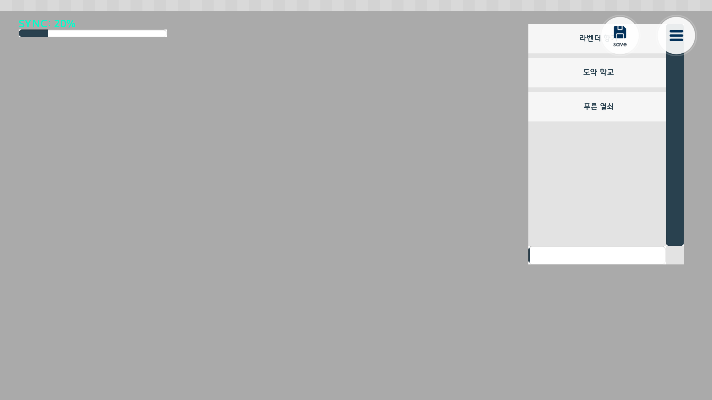
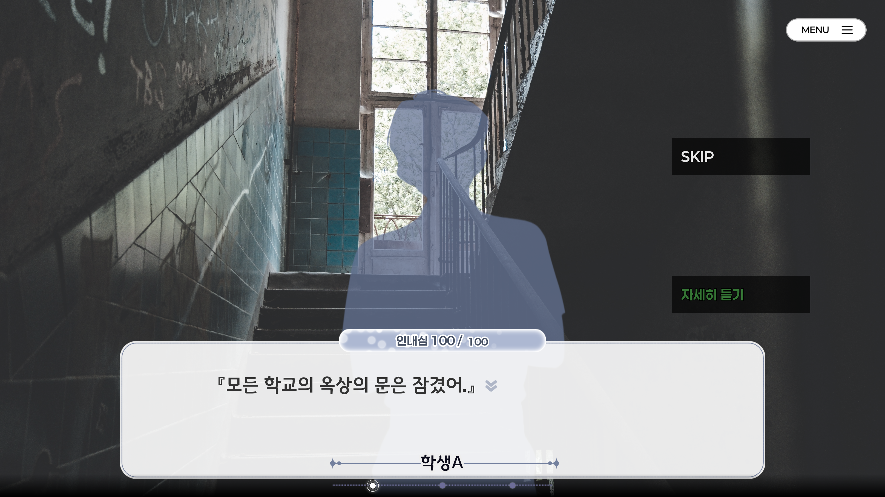
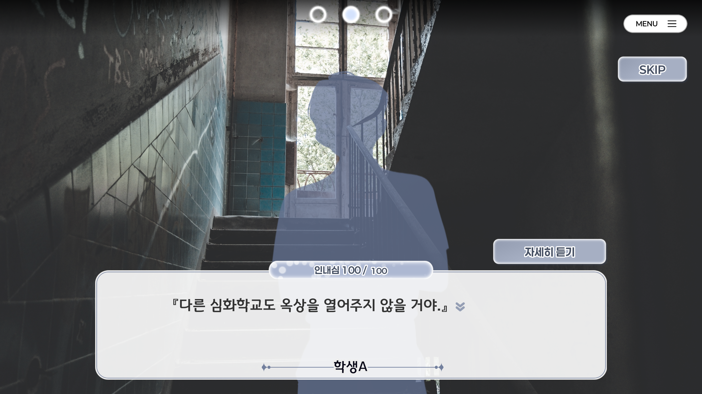

> 때는 2025년 6월, 날이 덥다고 느껴질 무렵

그X그녀의 계획은 훼방X훼방을 개발하고 난 뒤에 차기작을 만들기로 결정하게 되었습니다.
​
본래 우리들의 날개는 언제부턴가 부서졌다의 발매와 더불어, 크게 만들고 싶은 게임이 있었습니다. 그 시작 작업을 하기 위해, 기존의 마무리 되지 않은 게임을 마무리 하는 작업과 더불어, 보여주고 싶었던 게임을 만들기 위해 밑바탕을 만들고 있었습니다. 그X그녀의 계획은 훼방X훼방에서 등장하는 N도 그 흔적이며, 이번 표류하는 이탈자는 궤적이 없다에서도 다양한 이야기를 경험하실 수 있습니다.
​
다양한 엔딩을 보여주고 싶었습니다. 엔딩이 다양하고, 각종 배드 엔딩으로 빠질 수 있고. 그렇지만 플레이에 있어서 기분 나쁘지는 않은 그 간극을 조절해서 개발하고 싶었습니다. 특히 등장하는 히로인은 모두 매력적인데요. 그 히로인의 다양한 모습을 다양한 엔딩으로 보여주고 싶었고, 이번 표류하는 이탈자는 궤적이 없다의 개발로 통해 달성할 수 있었습니다.
​
​

비주얼 노벨 자체만으로 제공하는 방식보다는, 각각의 게임마다의 특징을 살리는 것도 중요하다는 생각이 들었습니다.
기존 게임의 리메이크에는 포함되지 않는 작업이지만 앞으로 개발될 신규 프로젝트에는 그 프로젝트에 어울리는 미니게임이 추가 될 예정입니다.
​
그X그녀의 계획은 훼방X훼방의 경우는 각 페이즈 별로 맵을 이동해서 정보를 수집하는 거대한 미니게임이 게임 자체의 정체성이 되었는데요, 이번 개발한 표류하는 이탈자는 궤적이 없다는 비주얼 노벨을 큰 줄기를 잡고, 중간중간에 미니게임을 제공하는 형태로 만들 계획이였습니다.
비주얼 노벨을 개발할 때마다 떠오르는 대표적인 게임은 역전재판인데요. 대사를 탐색하고, 대사를 지적하고, 오브젝트를 제시하는 방식의 미니게임은 플레이 할 때마다 두근거림을 줬었습니다. 이번에 개발한 표류하는 이탈자는 궤적이 없다는 굉장히 많은 영향을 받았습니다.
​

공개된 스크린샷과 비교하면 차이가 많은데요, 기획 자체는 초기 단계나 발매 단계나 동일하지만 미니게임의 사양은 많이 변경 되었습니다.
본래는 백과사전에서 연계된 습득 된 단어를 이용해서 상대방의 대사에 따라 단어를 제시하여서 상대방의 SYNC(가칭)을 올리는 방식이였는데요. 여러 문제에 부딪쳐서 사양의 변경이 필요하다는 걸 느꼈습니다.
​

공개된 스크린샷과 많이 비슷해진 모습입니다. 기존의 백과사전의 기능을 삭제하며, 미니게임의 사양을 지금과 같이 변경하였습니다.
​
하지만 이 때는 자세히 듣기 & 지적하기 기능이 제대로 정해지지 않은 상태였습니다. 본래는 더욱 더 다양한 액션을 할 수 있었는데, 플레이어 입장에서 너무 헷갈릴 것 같아 액션은 두 가지로 고정하였습니다.
​

내부 테스트 결과, 전체적인 대사의 흐름을 알 수가 없다는 것을 확인하여 상단에 인디케이터를 추가했습니다. 디자인도 현재와 많이 비슷해진 모습이죠.
​
SKIP 기능은 본래 디버그 모드에서만 사용 가능하게 만든 임시 기능입니다. 하지만 항상 느끼는 것이 미니게임이 게임 플레이에 있어서 불편함을 줘서는 안된다고 생각하는데요. 그X그녀의 계획은 훼방X훼방에서도 미니게임은 아예 넘길 수 있게 제작된 것처럼, 이번 표류하는 이탈자는 궤적이 없다에서도 미니게임은 달성하였을 때 새로운 것을 볼 수 있게 사양을 조절하고, 넘길 수 있는 기능을 넣는 것이 좋다는 생각이 들었습니다. (실제로 어떻게 완성이 될지 모르겠네요.)
​
그X그녀의 계획은 훼방X훼방와는 다르게 미니게임의 난이도를 낮췄기 때문에 장벽 같은 느낌은 전혀 들지 않을 겁니다.
​
감사합니다.